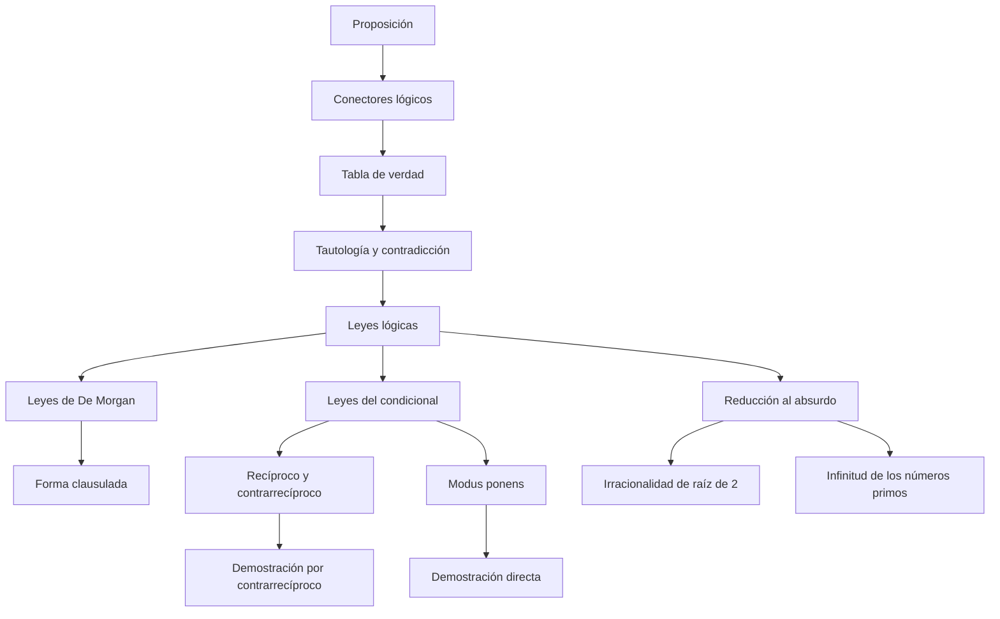

# Cap 1 · Nociones de lógica

> [!tip] Resumen en 5 minutos
> - Una **proposición** es una frase que es **verdadera (1) o falsa (0)**, sin ambigüedad.
> - Con **conectores** ($\neg, \land, \lor, \to, \leftrightarrow$) se construyen proposiciones compuestas; su valor se calcula con **tablas de verdad**.
> - Una **tautología** es siempre verdadera. Las **leyes lógicas** son tautologías que permiten sustituir una expresión por otra equivalente.
> - Lo más importante del capítulo: $p\to q \equiv \neg p\lor q$, **De Morgan** y $p\to q \equiv \neg q\to\neg p$ (**contrarrecíproco**).
> - Esas leyes son la base de los **métodos de demostración**: directo, por contrarrecíproco y por reducción al absurdo.

## Orden de lectura

**1. El lenguaje**
1. [[Proposición]]
2. [[Conectores lógicos]] → [[Negación]] · [[Conjunción]] · [[Disyunción]] · [[Condicional]] · [[Bicondicional]]
3. [[Recíproco y contrarrecíproco]]
4. [[Tabla de verdad]]
5. [[Tautología y contradicción]]

**2. Las leyes**
6. [[Leyes lógicas]] (chuleta con todas)
7. [[Leyes de De Morgan]] · [[Tercio excluso y no contradicción]] · [[Leyes del condicional]]
8. Reglas de inferencia: [[Modus ponens]] · [[Modus tollens]] · [[Silogismo hipotético]] · [[Silogismo disyuntivo]]
9. [[Implicación y equivalencia lógica]] · [[Condición necesaria y condición suficiente]]

**3. Comprobar si algo es una tautología**
10. Con tabla: [[Tabla de verdad]]
11. [[Validación por refutación]]
12. [[Forma clausulada]]

**4. Cómo se hacen las matemáticas** (comentarios del capítulo)
13. [[Sistema axiomático]] · [[Definición, teorema, lema y corolario]]
14. [[Métodos de demostración]] → [[Demostración directa]] · [[Demostración por contrarrecíproco]] · [[Reducción al absurdo]]
15. Ejemplos famosos: [[Irracionalidad de raíz de 2]] · [[Infinitud de los números primos]] · [[Unicidad del límite de una sucesión]]

**Ejercicios:** [[LM Ejercicios Cap 1]]

## Mapa de dependencias

## Siguiente capítulo
[[LM Cap 2 - Conjuntos]]: aparecen los **predicados** (proposiciones con variables) y los **cuantificadores** $\forall, \exists$.
