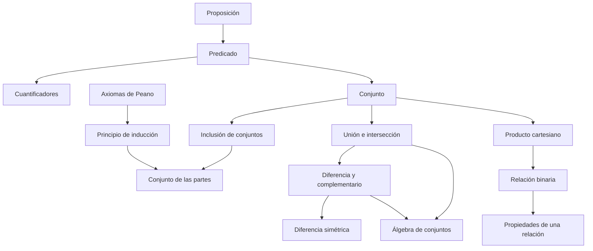

# Cap 2 · Conjuntos

> [!tip] Resumen en 5 minutos
> - Un **conjunto** queda determinado por sus elementos. Se puede dar por **extensión** $\{1,2\}$ o por **comprensión** $\{x\in C\mid P(x)\}$.
> - Un **predicado** $P(x)$ es una "proposición con hueco": se vuelve verdadera o falsa al dar valor a $x$. Los **cuantificadores** $\forall$ y $\exists$ convierten predicados en proposiciones.
> - **Negar cuantificadores:** $\neg\forall x\,P \iff \exists x\,\neg P$ y $\neg\exists x\,P\iff\forall x\,\neg P$. Para refutar un "para todo" basta **un contraejemplo**.
> - Las operaciones de conjuntos son la lógica disfrazada: $\cup\leftrightarrow\lor$, $\cap\leftrightarrow\land$, complementario $\leftrightarrow\neg$, $\subseteq\leftrightarrow\to$.
> - **Igualdad por doble inclusión:** $A=B\iff A\subseteq B$ y $B\subseteq A$. Es *la* técnica para probar igualdades de conjuntos.
> - El **producto cartesiano** $A\times B$ (pares ordenados) permite definir **relaciones**: una relación es un subconjunto de $A\times B$.
> - **Inducción**: si $P(0)$ y $P(n)\Rightarrow P(n+1)$, entonces $P(n)$ para todo $n$.

## Orden de lectura

**1. Conjuntos y lógica de predicados** (§2.1)
1. [[Conjunto]] (pertenencia, extensión, comprensión, vacío)
2. [[Predicado]]
3. [[Cuantificadores]]
4. [[Inclusión de conjuntos]]
5. [[Conjunto de las partes]]
6. [[Principio de inducción]] y [[Definición por recurrencia]] (presentados con los [[Axiomas de Peano]])

**2. Operaciones** (§2.2-2.3)
7. [[Unión e intersección]]
8. [[Diferencia y complementario]]
9. [[Diferencia simétrica]]
10. [[Familias de conjuntos]]
11. [[Álgebra de conjuntos]] (chuleta paralela a [[Leyes lógicas]])

**3. Pares y relaciones** (§2.4-2.5)
12. [[Producto cartesiano]]
13. [[Relación binaria]] (relación inversa, imagen, original, composición)

**4. Comentarios**
14. [[Paradoja de Russell]] y [[Axiomas de Zermelo-Fraenkel]]

**Ejercicios:** [[LM Ejercicios Cap 2]]

## Mapa de dependencias

## Capítulos vecinos
- [[LM Cap 1 - Nociones de lógica]]: cada operación de conjuntos es un conector lógico.
- [[LM Cap 3 - Relaciones y aplicaciones]]: relaciones de equivalencia, de orden y funciones.
