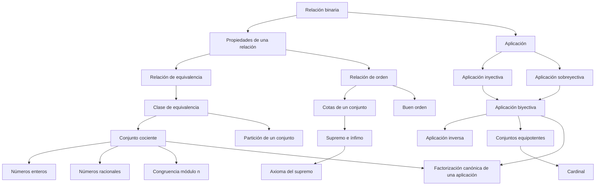

# Cap 3 · Relaciones y aplicaciones entre conjuntos

> [!tip] Resumen en 5 minutos
> - Una relación en $U$ puede ser **reflexiva, simétrica, antisimétrica, transitiva**.
> - **Equivalencia** = reflexiva + simétrica + transitiva. **Clasifica**: parte el conjunto en **clases** disjuntas. Juntar cada clase en un punto da el **conjunto cociente** $U/\!\sim$. Así se construyen $\mathbb Z$, $\mathbb Q$, $\mathbb Z/n$.
> - **Orden** = reflexiva + antisimétrica + transitiva. **Ordena**. Puede ser total o parcial. Conceptos: cotas, máximo, mínimo, **supremo** (la menor cota superior), ínfimo, maximal, minimal, **buen orden**.
> - Una **aplicación** es una relación donde cada elemento tiene **exactamente una** imagen.
>   - **Inyectiva:** imágenes distintas para elementos distintos.
>   - **Sobreyectiva:** todo el conjunto final se alcanza.
>   - **Biyectiva:** las dos cosas ⇔ tiene **inversa**.
> - **Factorización canónica:** toda aplicación = proyección (sobre) ∘ biyección ∘ inclusión (iny.).
> - Dos conjuntos con una biyección entre ellos tienen el mismo **cardinal** ("tamaño").

## Orden de lectura

**1. Relaciones en un conjunto** (§3.1-3.2)
1. [[Propiedades de una relación]]
2. [[Relación de equivalencia]] → [[Clase de equivalencia]] → [[Conjunto cociente]]
3. [[Partición de un conjunto]] (equivalencia ⇔ partición)
4. Ejemplo clave: [[Congruencia módulo n]]

**2. Orden** (§3.3)
5. [[Relación de orden]] · [[Orden lexicográfico y orden producto]] · [[Intervalos]]
6. [[Cotas de un conjunto]] → [[Máximo y mínimo]] → [[Supremo e ínfimo]] · [[Elementos maximales y minimales]]
7. [[Buen orden]]

**3. Aplicaciones** (§3.4)
8. [[Aplicación]] · [[Imagen y antiimagen]] · [[Composición de aplicaciones]]
9. [[Aplicación inyectiva]] · [[Aplicación sobreyectiva]] · [[Aplicación biyectiva]]
10. [[Aplicación inversa]] · [[Inversas laterales]]
11. [[Factorización canónica de una aplicación]]

**4. Tamaño de conjuntos**
12. [[Conjuntos equipotentes]] → [[Cardinal]]
13. Comentarios: [[Axioma de elección]] · [[Lema de Zorn]] · [[Teorema de Cantor-Bernstein]] · [[Teorema de Cantor]]

**Ejercicios:** [[LM Ejercicios Cap 3]]

## Mapa de dependencias

## Capítulos vecinos
- [[LM Cap 2 - Conjuntos]]: una relación es un subconjunto de $A\times B$.
- [[LM Cap 4 - Operaciones y estructuras algebraicas]]: una operación es una aplicación $A\times A\to A$.
