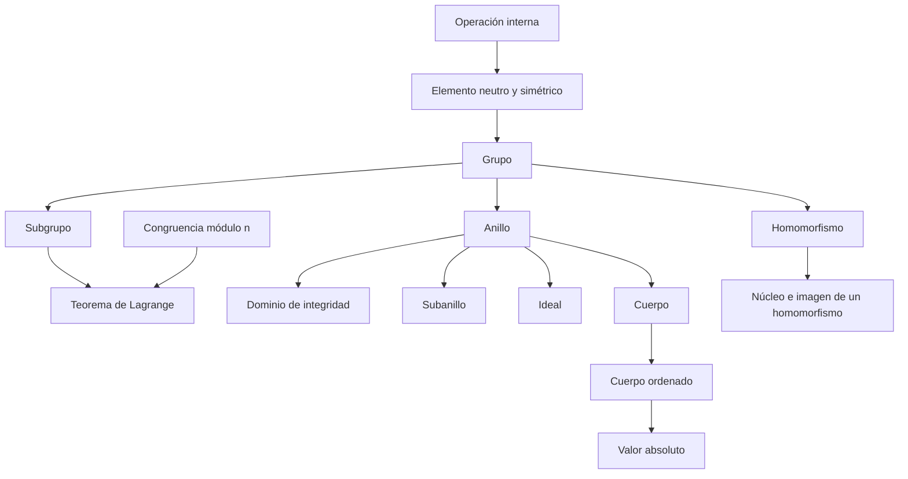

# Cap 4 · Operaciones internas y estructuras algebraicas

> [!tip] Resumen en 5 minutos
> - Una **operación interna** en $E$ es una aplicación $E\times E\to E$. Se le piden propiedades: asociativa, conmutativa, neutro, simétrico.
> - **Grupo** = asociativa + neutro + simétricos. **Anillo** = grupo abeliano $(+)$ + producto asociativo y distributivo. **Cuerpo** = anillo conmutativo con unidad donde todo $\neq0$ tiene inverso.
> - En cada estructura valen ciertas reglas "como con números" y otras no. En matrices **no** vale $ab=ba$; en $\mathbb Z/6$ **no** vale "$ab=0\Rightarrow a=0$ o $b=0$".
> - **Subestructuras** (subgrupo, subanillo, ideal, subcuerpo) se reconocen con un criterio corto ($a-b\in H$…).
> - **Teorema de Lagrange:** en un grupo finito, el orden de un subgrupo divide al orden del grupo.
> - Un **cuerpo ordenado** permite trabajar con desigualdades: $a^2\ge0$, $0<1$, $|a+b|\le|a|+|b|$.
> - Un **homomorfismo** conserva las operaciones. Es inyectivo ⇔ su **núcleo** es $\{0\}$. Un **isomorfismo** permite identificar estructuras: así se entiende $\mathbb N\subset\mathbb Z\subset\mathbb Q\subset\mathbb R\subset\mathbb C$.

## Orden de lectura

**1. Operaciones** (§4.1)
1. [[Operación interna]] → [[Elemento neutro y simétrico]]

**2. Grupos** (§4.2)
2. [[Grupo]] → [[Subgrupo]] → [[Teorema de Lagrange]]

**3. Anillos y cuerpos** (§4.3-4.4)
3. [[Anillo]] · [[Binomio de Newton]] · [[Dominio de integridad]]
4. [[Subanillo]] · [[Ideal]]
5. [[Cuerpo]]

**4. Orden y operaciones** (§4.5)
6. [[Cuerpo ordenado]] (grupo, anillo y cuerpo ordenados) · [[Valor absoluto]]

**5. Homomorfismos** (§4.6)
7. [[Homomorfismo]] → [[Núcleo e imagen de un homomorfismo]]

**6. Comentarios**
8. [[Suma y producto de cardinales]]

**Ejercicios:** [[LM Ejercicios Cap 4]]

## Mapa de dependencias

## Para profundizar (tus otros resúmenes)
- [[resumen_teoriadegrupos]]
- [[resumen_cuerposanillosyteoriadegalois]]
- [[algebra_subgrupos]] (tu mapa del álgebra)

## Capítulos vecinos
- [[LM Cap 3 - Relaciones y aplicaciones]]
- [[LM Cap 5 - Números naturales y enteros]]: $\mathbb Z$ como anillo, divisibilidad.
