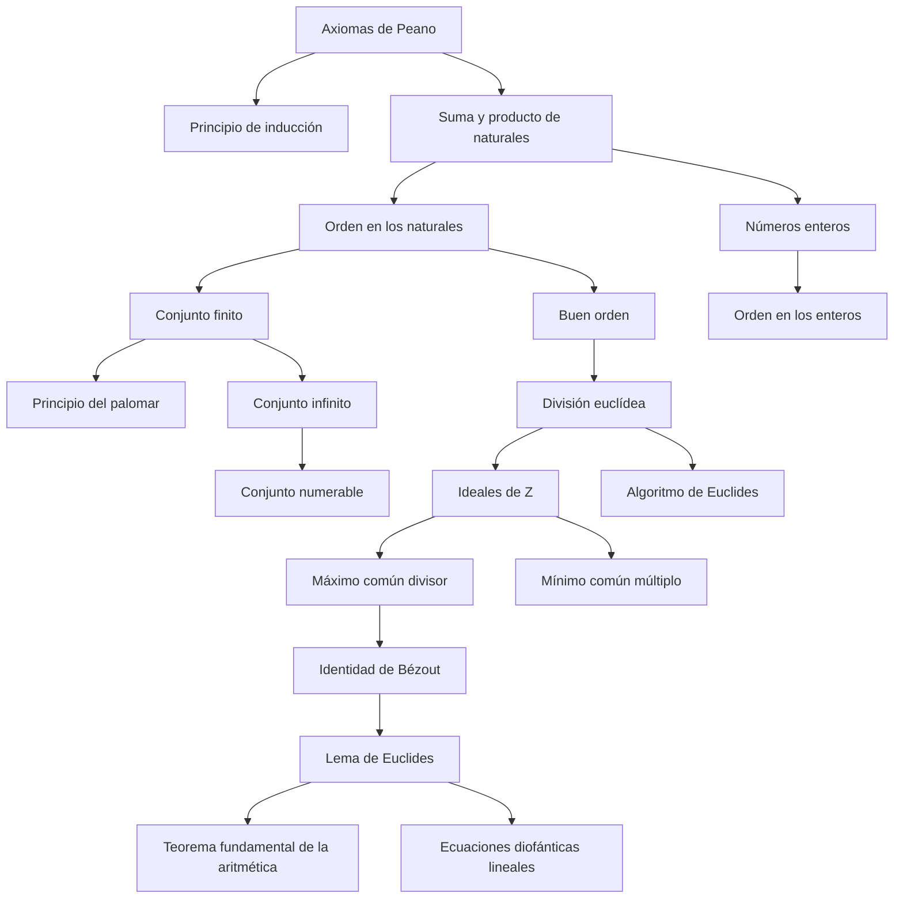

# Cap 5 · Los números naturales y los números enteros

> [!tip] Resumen en 5 minutos
> - $\mathbb N$ se define con los **axiomas de Peano** (0, sucesor, inducción). La **suma** y el **producto** se definen **por recurrencia** y todas sus propiedades (asociativa, conmutativa…) se demuestran **por inducción**.
> - El orden $m\le n\iff\exists p:\ m+p=n$ es total, compatible y **bien ordenado**.
> - **Finito** = biyectable con $\{1,\dots,n\}$. Entre finitos del mismo tamaño, inyectiva ⇔ sobreyectiva ⇔ biyectiva (**falso para infinitos**). Fórmulas de conteo: $|A\cup B|+|A\cap B|=|A|+|B|$, $|A\times B|=|A||B|$, $|B^A|=|B|^{|A|}$, $|\mathcal P(A)|=2^{|A|}$.
> - **Numerable** = biyectable con $\mathbb N$. Lo son $\mathbb N^2$, $\mathbb Z$, $\mathbb Q$ y las uniones numerables de numerables. $\mathcal P(\mathbb N)$ **no**.
> - $\mathbb Z=(\mathbb N\times\mathbb N)/\!\sim$ con $(a,b)\sim(c,d)\iff a+d=b+c$. Es un **anillo conmutativo unitario totalmente ordenado** sin divisores de cero.
> - **División euclídea:** $a=qb+r$, $0\le r<b$, únicos. ⇒ todo ideal de $\mathbb Z$ es $n\mathbb Z$ ⇒ existen **mcd** y **mcm**, y la **identidad de Bézout** $d=au+bv$. El **algoritmo de Euclides** calcula el mcd. **Teorema de Gauss:** $a\mid bc$, $\operatorname{mcd}(a,b)=1\Rightarrow a\mid c$.

## Orden de lectura

**1. Los naturales** (§5.1)
1. [[Axiomas de Peano]] → [[Números naturales]]
2. [[Suma y producto de naturales]] (definidos por [[Definición por recurrencia|recurrencia]], probados por [[Principio de inducción|inducción]])
3. [[Orden en los naturales]] ([[Buen orden]])

**2. Contar** (§5.2-5.3)
4. [[Conjunto finito]] → [[Principio del palomar]]
5. Conteo: [[Número combinatorio]]
6. [[Conjunto infinito]] → [[Conjunto numerable]] · [[Teorema de Cantor]]

**3. Los enteros** (§5.4)
7. [[Números enteros]] → [[Orden en los enteros]]

**4. Divisibilidad** (§5.5)
8. [[División euclídea]] → [[Ideales de Z]]
9. [[Divisibilidad]] → [[Mínimo común múltiplo]] · [[Máximo común divisor]]
10. [[Identidad de Bézout]] · [[Algoritmo de Euclides]]
11. [[Lema de Euclides]] (teorema de Gauss) → [[Ecuaciones diofánticas lineales]]
12. Complemento (no está en el libro): [[Números primos]] · [[Teorema fundamental de la aritmética]]

**Ejercicios:** [[LM Ejercicios Cap 5]]

## Mapa de dependencias

## Capítulos vecinos
- [[LM Cap 4 - Operaciones y estructuras algebraicas]]: $\mathbb Z$ es el ejemplo modelo de anillo.
- [[LM Cap 6 - Números racionales y reales]]: se construye $\mathbb Q$ desde $\mathbb Z$.
