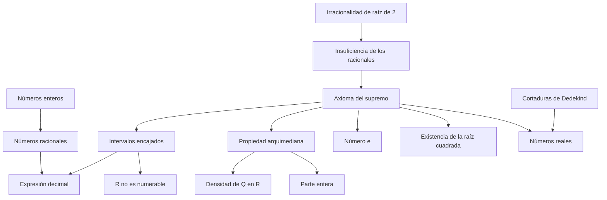

# Cap 6 · Los números racionales y los números reales

> [!tip] Resumen en 5 minutos
> - $\mathbb Q=(\mathbb Z\times\mathbb Z^*)/\!\sim$ con $(a,b)\sim(c,d)\iff ad=bc$. Es un **cuerpo ordenado**, arquimediano y **denso** (entre dos racionales siempre hay otro). Es numerable.
> - Pero $\mathbb Q$ **tiene agujeros**: $\{x\ge0\mid x^2<2\}$ está acotado y **no tiene supremo en $\mathbb Q$**.
> - $\mathbb R$ es **el** cuerpo ordenado que cumple el **axioma del supremo** (único salvo isomorfismo). De ahí salen: raíces cuadradas, el número $e$, la parte entera, la propiedad arquimediana, los intervalos encajados, la expresión decimal…
> - $\mathbb Q$ y los irracionales son **densos** en $\mathbb R$. $\mathbb R$ **no es numerable** (los irracionales son "muchísimos más" que los racionales).
> - $\mathbb R$ se puede **construir** desde $\mathbb Q$: con sucesiones de Cauchy o con **cortaduras de Dedekind**.

## Orden de lectura

**1. Racionales** (§6.1-6.2)
1. [[Números racionales]] · [[Densidad de Q en R]] (orden divisible)
2. [[Expresión decimal]]

**2. El problema** (§6.3)
3. [[Insuficiencia de los racionales]] (y [[Irracionalidad de raíz de 2]])

**3. Los reales** (§6.4)
4. [[Axioma del supremo]] → [[Números reales]]
5. Consecuencias: [[Existencia de la raíz cuadrada]] · [[Número e]] · [[Valor absoluto]] · [[Parte entera]] · [[Propiedad arquimediana]]

**4. Topología de la recta** (§6.5)
6. [[Intervalos]] (caracterización en $\mathbb R$) · [[Densidad de Q en R]] · [[Intervalos encajados]]
7. [[R no es numerable]] · [[Números algebraicos y trascendentes]]

**5. Comentarios**
8. [[Cortaduras de Dedekind]] (construcción de $\mathbb R$)

**Ejercicios:** [[LM Ejercicios Cap 6]]

## Mapa de dependencias

## Para profundizar
- El análisis real empieza aquí: [[asignaturas]] (tus asignaturas de análisis).

## Capítulos vecinos
- [[LM Cap 5 - Números naturales y enteros]]
- [[LM Cap 7 - Números complejos]]: $\mathbb C$ se construye sobre $\mathbb R^2$ para que $x^2+1=0$ tenga solución.
