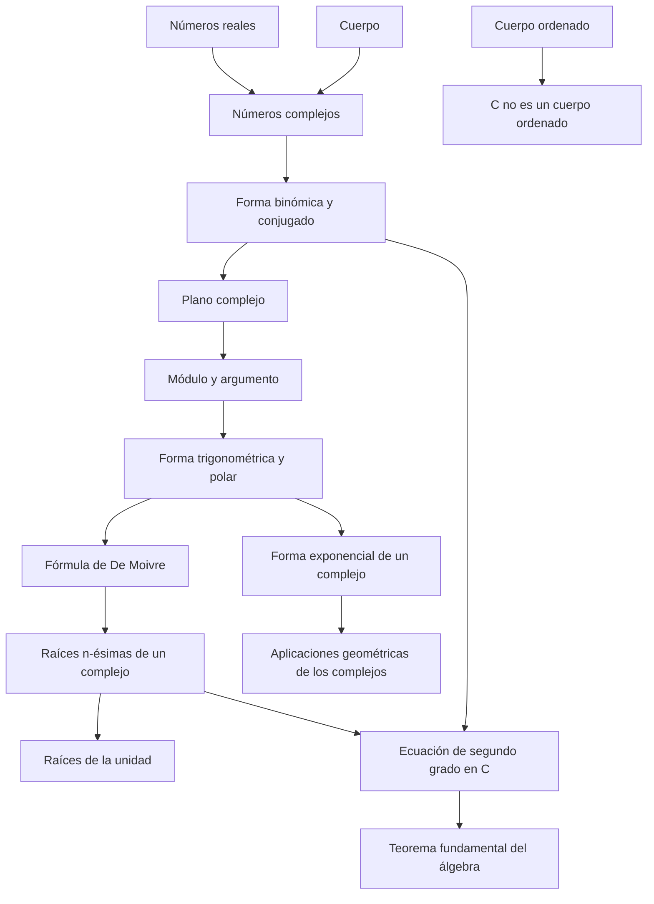

# Cap 7 · Los números complejos

> [!tip] Resumen en 5 minutos
> - Problema: en $\mathbb R$, $x^2=-1$ no tiene solución. Se construye $\mathbb C=\mathbb R^2$ con $(a,b)(a',b')=(aa'-bb',\,ab'+a'b)$: es un **cuerpo** que contiene a $\mathbb R$ y donde $i=(0,1)$ cumple $i^2=-1$.
> - Tres formas de escribir $z$: **binómica** $a+ib$ (buena para sumar), **trigonométrica/polar** $r(\cos\alpha+i\sin\alpha)=r_\alpha$ y **exponencial** $re^{i\alpha}$ (buenas para multiplicar, potencias y raíces).
> - **Multiplicar = multiplicar módulos y sumar argumentos.** De ahí: **De Moivre** $(\cos\alpha+i\sin\alpha)^n=\cos n\alpha+i\sin n\alpha$ y las **raíces $n$-ésimas**: $n$ raíces repartidas en un polígono regular.
> - Toda ecuación de segundo grado (incluso con coeficientes complejos) se resuelve con la fórmula de siempre. **Teorema fundamental del álgebra:** todo polinomio no constante tiene raíz en $\mathbb C$.
> - $\mathbb C$ **no se puede ordenar** de forma compatible. A cambio, es perfecto para la **geometría plana**: traslaciones, giros, homotecias y simetrías son operaciones con complejos.

## Orden de lectura

**1. Construcción** (§7.1-7.2)
1. [[Números complejos]] → [[Forma binómica y conjugado]]

**2. Geometría** (§7.3)
2. [[Plano complejo]] → [[Módulo y argumento]] → [[Forma trigonométrica y polar]]
3. [[Fórmula de De Moivre]]

**3. Exponencial y raíces** (§7.4-7.5)
4. [[Forma exponencial de un complejo]] (fórmulas de Euler)
5. [[Raíces n-ésimas de un complejo]] → [[Raíces de la unidad]]
6. [[Ecuación de segundo grado en C]]

**4. Aplicaciones** (§7.6)
7. [[Aplicaciones geométricas de los complejos]]

**5. Comentarios**
8. [[C no es un cuerpo ordenado]] · [[Teorema fundamental del álgebra]]

**Ejercicios:** [[LM Ejercicios Cap 7]]

## Mapa de dependencias

## Para profundizar
- [[resumen_completo_ahlfors]] (análisis complejo)

## Capítulo anterior
- [[LM Cap 6 - Números racionales y reales]]
- Volver al libro: [[LM - Lenguaje matemático, conjuntos y números]]
