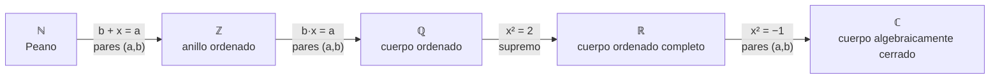

# Lenguaje matemático, conjuntos y números

> [!abstract] De qué va este libro
> Es el **cimiento** de todo lo demás: el lenguaje (lógica), los objetos básicos (conjuntos, relaciones, aplicaciones), las estructuras (grupos, anillos, cuerpos) y la **construcción de todos los números** $\mathbb N\subset\mathbb Z\subset\mathbb Q\subset\mathbb R\subset\mathbb C$.
> Delgado Pineda y Muñoz Bouzo · UNED (1.º del grado en Matemáticas) · PDF: [[lenguaje_matematico_conjuntos_numeros.pdf]]
>
> En este vault, las notas de este libro llevan el prefijo **LM**.

## Capítulos

| # | Capítulo | En una frase |
|---|---|---|
| 1 | [[LM Cap 1 - Nociones de lógica]] | Proposiciones, conectores, leyes lógicas y **cómo se demuestra** |
| 2 | [[LM Cap 2 - Conjuntos]] | Conjuntos, **cuantificadores**, operaciones, producto cartesiano, **inducción** |
| 3 | [[LM Cap 3 - Relaciones y aplicaciones]] | **Equivalencia** (clasificar), **orden** (supremo), **aplicaciones** (inyectiva, sobre, biyectiva), cardinales |
| 4 | [[LM Cap 4 - Operaciones y estructuras algebraicas]] | **Grupos, anillos, cuerpos**, orden compatible, homomorfismos |
| 5 | [[LM Cap 5 - Números naturales y enteros]] | Peano, conteo, numerables, $\mathbb Z$, **división euclídea, mcd, Bézout** |
| 6 | [[LM Cap 6 - Números racionales y reales]] | $\mathbb Q$, **axioma del supremo**, densidad, $\mathbb R$ no numerable, Dedekind |
| 7 | [[LM Cap 7 - Números complejos]] | $\mathbb C$, forma polar, **De Moivre**, raíces, geometría |

Ejercicios con solución: [[LM Ejercicios Cap 1|Cap 1]] · [[LM Ejercicios Cap 2|Cap 2]] · [[LM Ejercicios Cap 3|Cap 3]] · [[LM Ejercicios Cap 4|Cap 4]] · [[LM Ejercicios Cap 5|Cap 5]] · [[LM Ejercicios Cap 6|Cap 6]] · [[LM Ejercicios Cap 7|Cap 7]]

## La gran idea: construir los números

Cada vez que una ecuación no tiene solución, se **construye** un conjunto más grande donde sí la tiene. El patrón casi siempre es el mismo: **pares + relación de equivalencia + cociente** ([[Conjunto cociente]]).

| Paso | Problema | Construcción | Lo que se gana | Lo que se pierde |
|---|---|---|---|---|
| [[Números naturales\|ℕ]] | contar | [[Axiomas de Peano]] | inducción, buen orden | restar |
| [[Números enteros\|ℤ]] | $b+x=a$ | $(\mathbb N\times\mathbb N)/\!\sim$ | grupo aditivo, anillo | buen orden |
| [[Números racionales\|ℚ]] | $bx=a$ | $(\mathbb Z\times\mathbb Z^*)/\!\sim$ | cuerpo, densidad | orden discreto |
| [[Números reales\|ℝ]] | $x^2=2$ | [[Axioma del supremo]] / [[Cortaduras de Dedekind]] | completitud | numerabilidad |
| [[Números complejos\|ℂ]] | $x^2=-1$ | $\mathbb R^2$ con producto nuevo | [[Teorema fundamental del álgebra\|toda ecuación polinómica]] | **el orden** |

## Teoremas estrella (los que más se usan después)

**Lógica y demostración**
- [[Leyes de De Morgan]] · [[Leyes del condicional]] · [[Recíproco y contrarrecíproco]]
- [[Reducción al absurdo]] · [[Principio de inducción]] · [[Métodos de demostración]]

**Conjuntos, relaciones y aplicaciones**
- [[Partición de un conjunto]] (equivalencia ⇔ partición)
- [[Aplicación inversa]] (biyectiva ⇔ invertible) · [[Inversas laterales]]
- [[Factorización canónica de una aplicación]]
- [[Teorema de Cantor]] · [[Teorema de Cantor-Bernstein]]

**Álgebra**
- [[Grupo]] (cancelativa, $(ab)^{-1}=b^{-1}a^{-1}$) · [[Subgrupo]] (criterio) · [[Teorema de Lagrange]]
- [[Núcleo e imagen de un homomorfismo]] (inyectivo ⇔ núcleo trivial)
- [[Binomio de Newton]] · [[Cuerpo ordenado]] (reglas de desigualdades)

**Números**
- [[División euclídea]] · [[Identidad de Bézout]] · [[Lema de Euclides]] · [[Algoritmo de Euclides]]
- [[Conjunto numerable]] ($\mathbb Q$ numerable) · [[R no es numerable]]
- [[Axioma del supremo]] · [[Propiedad arquimediana]] · [[Densidad de Q en R]] · [[Intervalos encajados]]
- [[Irracionalidad de raíz de 2]] · [[Infinitud de los números primos]]
- [[Fórmula de De Moivre]] · [[Raíces n-ésimas de un complejo]] · [[Teorema fundamental del álgebra]]

## Qué viene después
Con este libro tienes las herramientas para:
- **Álgebra lineal** → [[resumen_algebralineal]] (espacios vectoriales sobre un [[Cuerpo]], aplicaciones lineales = [[Homomorfismo|homomorfismos]])
- **Teoría de grupos** → [[resumen_teoriadegrupos]] (sigue a [[Grupo]], [[Subgrupo]], [[Teorema de Lagrange]])
- **Anillos, cuerpos y Galois** → [[resumen_cuerposanillosyteoriadegalois]] (sigue a [[Anillo]], [[Ideal]], [[Cuerpo]])
- **Análisis real** → [[asignaturas]] (sigue a [[Axioma del supremo]], [[Unicidad del límite de una sucesión]])
- **Análisis complejo** → [[resumen_completo_ahlfors]] (sigue a [[Números complejos]])

Volver a [[Inicio]]
